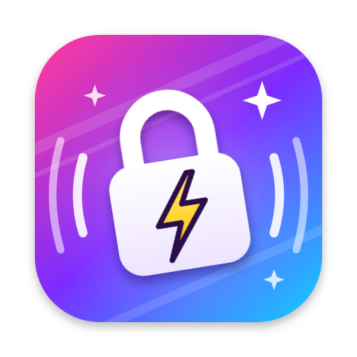

<div align="center">



# Rokkin（ロッキン）

**脱線しても、秒で戻る。 Lock in. ⚡**

ADHDの「気づいたらスマホ」を、研究で効果が示された7つの集中バフで止める Mac のメニューバーアプリ。<br>
Claude Code を回しながらの QA・開発にも対応。無料・オープンソース。

[**🎬 解説動画を見る（72秒）**](https://79yuuki.github.io/rokkin/#video) ・ [**🌐 サイト**](https://79yuuki.github.io/rokkin/) ・ [**⬇️ 入手する**](#入手する)

<a href="https://79yuuki.github.io/rokkin/#video"></a>

<sub>▲ クリックでサイトの動画へ。MP4 を直接見るなら <a href="docs/assets/rokkin-explainer.mp4">docs/assets/rokkin-explainer.mp4</a></sub>

</div>

> Rokkin は医療機器ではありません。薬物療法やカウンセリングなどの治療の代わりではなく、日々の作業を補助するツールです。

---

## 7つの集中バフ

| | バフ | 何をするか | 根拠 |
|---|---|---|---|
| 01 | **始める前に、決めろ。** | やることを1行書いて Enter で開始（空欄でもOK）。「調べたくなったら → メモして戻る」のような if-then プランは最初から入っていて、完了の定義は書きたいときだけ | if-then プラン（実行意図）は94研究・8000人超のメタ分析で目標達成を後押し（**d=0.65**）。ADHDの子どもでも反応の抑制・注意の切り替えが改善（Gollwitzer & Sheeran 2006; Gawrilow & Gollwitzer 2008, 2011） |
| 02 | **「今、集中してた？」** | ランダムな間隔で「注意が向いてた？」と聞く。はいが続けば🔥コンボ、いいえなら何に引っ張られたかを1タップ。「気づけたら勝ち」として if-then プランを返す | 注意の自己モニタリングは **41研究** のレビューでADHDの授業中の集中行動を改善（Bruhn et al. 2015）。インターバルタイマーで off-task 46.8% → 27.3%（Sluiter et al. 2019）。※主に子ども・学生の研究 |
| 03 | **調べたい？ 駐車場へ。** | <kbd>⌃⌥M</kbd> で思いつきを書いて即戻る。休憩でまとめて片付ける | 成人ADHDの認知行動療法（**RCT** で効果）の「distractibility delay」（Safren et al. 2005, 2010） |
| 04 | **開く前に、ひと呼吸。** | 決めておいたアプリ・サイトを開くと、5秒の間と「作業に戻る／メモして戻る／5分だけ使う」。禁止はしない | 短い待ち＋「やめる」選択肢で、6週間後に対象アプリを開く回数が **−57%**。一番効いたのは「やめる」選択肢（Grüning et al., PNAS 2023） |
| 05 | **待ち時間を、観察タイムに。** | Claude Code の hooks で「実行中・完了・入力待ち」を表示。実行中は「今の操作、QAケースの手順と一致してる？」などの問いを出し、終わったら音で呼び戻す | ゆっくりしたペースの課題でADHDの成績は落ちやすい（状態調整モデル、Metin et al. 2012 メタ分析）。この使い方自体の効果は未検証なので、記録で「Claude実行中」と「それ以外」の集中率を比較できる |
| 06 | **区切って、休む。🍅** | 決めた長さのブロック＋短い休憩。ポモドーロモード（25分＋5分、4回ごとに長い休憩）もワンタップ。ブロッククリアで紙吹雪 🏆（集中中は出ない）。背景ノイズは任意 | 決めた間隔の休憩は自分で決めるより疲労・注意散漫が少ない（Biwer et al. 2023）。ピンク/白ノイズはADHD傾向の人で小さな改善 **g=0.25**、そうでない人では逆効果（Nigg et al. 2024） |
| 07 | **自分専用に、進化する。** | 各ブロックで最初に「いいえ」が出るまでの時間の中央値から、次回のブロック長を提案。ノイズあり/なしの集中率も比較 | 自分の集中持続時間を測ってタイマーを合わせる（成人ADHDのCBT、Safren et al.） |

**Rokkin が約束すること**：責めない（気づけたら勝ち）／罰ゼロ／データは Mac から出ない。お祝い演出は「終わった瞬間」だけで、集中している最中は小窓以外なにも動きません。

---

## 入手する

必要なもの：macOS 13 以降、Xcode または Command Line Tools（`xcode-select --install`）

```bash
git clone https://github.com/79yuuki/rokkin.git
cd rokkin
./scripts/build-app.sh                       # build/Rokkin.app ができる
ditto build/Rokkin.app /Applications/Rokkin.app
open /Applications/Rokkin.app
```

- `swift build`（SwiftPM）が動かない環境では、自動で `swiftc` を直接呼ぶビルドに切り替わります（最初から使うなら `./scripts/build-app.sh --swiftc`）。Command Line Tools の更新が途中で止まって SDK とコンパイラのバージョンがずれている場合も、読める SDK を自動で選びます
- メニューバーに 🔒 アイコンが出ます（Dockには出ません）。作業中は両側に音の波がつきます
- ログイン時に自動起動：システム設定 → 一般 → ログイン項目 → Rokkin を追加
- 寄り道サイトの検出を初めて使うとき、「Rokkin が Safari / Chrome を制御」の許可を求められます（URL は Mac の外に出ません）

### Claude Code と一緒に使う

設定 → Claude Code → **「~/.claude/settings.json に hooks を追加」** を押すだけ。既存の設定は残して追記し、元のファイルはバックアップします。手動で入れる場合は同じ画面に貼り付け用 JSON があります。追加後、起動中の Claude Code は再起動してください。

hooks は `~/.rokkin/claude-events` に状態（running / waiting / stop）を1行書くだけで、ネットワーク通信はしません。

---

## 使い方（QA の1セッション）

1. **開始**：<kbd>⌃⌥L</kbd>（またはメニューバーから）→ やることを1行書いて Enter。空欄でもOK、長さはワンタップ。if-then プランは最初から3つ並んでいて、その場で追加・削除できる。完了の定義は「もっと設定する」から任意で
2. **作業中**：画面右上の小窓に、タスク・残り時間・Claude の状態・🔥コンボ
   - 自己チェックに <kbd>⌃⌥Y</kbd> / <kbd>⌃⌥N</kbd> で答える
   - 調べたくなったこと・気づいたことは <kbd>⌃⌥M</kbd> でメモ
3. **ブロッククリア**：紙吹雪 🏆 → 休憩。駐車場メモを片付ける。ポモドーロ以外のモードなら「+5分 延長戦」も可
4. **リザルト**：集中率、脱線のきっかけ、Claude 実行中とそれ以外の集中率、メモ。**Markdown でコピー** して Issue や QA レポートに貼れる

| キー | 動作 |
|---|---|
| <kbd>⌃⌥L</kbd> | 開始画面（Lock in） |
| <kbd>⌃⌥M</kbd> | メモ（後で見る・気づいたこと） |
| <kbd>⌃⌥Y</kbd> / <kbd>⌃⌥N</kbd> | 自己チェックに はい / いいえ |
| <kbd>⌃⌥H</kbd> | 小窓の表示切替 |

### 設定のヒント

- **iPhone も静かにしたい**：ショートカット App で「集中モードを設定（オン／オフ）」のショートカットを作り、設定 → 基本 に名前を入れる。集中モードの「デバイス間で共有」をオンにすると iPhone にも反映
- **QA に使っているブラウザで寄り道サイトを開いた**：「作業に戻る」でタブの切り替えを促します
- **紙吹雪がいらない**：設定 → 基本 →「お祝い」をオフ
- **自己チェックがうるさい**：間隔を広げる（広げすぎると脱線に気づくのが遅れます）

---

## データとプライバシー

- すべて `~/Library/Application Support/Rokkin/` に JSON で保存（settings / history / inbox / current）
- 外部送信は一切なし。Claude 連携は `~/.rokkin/claude-events` をローカルで読むだけ
- 進行中のセッションは逐次保存され、アプリが落ちても復元されます

## 開発

```bash
swift test                 # 中核ロジック（RokkinCore）のテスト。Linux でも動きます
swift run Rokkin           # .app にせず直接起動（macOS）
```

- `Sources/RokkinCore` — モデル、統計（集中率・持続時間の推定）、ポモドーロ、Claude Code hooks の読み取りとインストール、保存、レポート。Foundation のみ
- `Sources/Rokkin` — SwiftUI + AppKit のメニューバーアプリ（小窓、各ウィンドウ、ホットキー、寄り道検出、ノイズ生成、お祝い演出）
- `docs/` — GitHub Pages のサイト（WebGL シェーダーの背景と解説動画）

## 参考文献

- Bruhn, McDaniel & Kreigh (2015). Self-monitoring interventions for students with behavior problems: A systematic review. *Behavioral Disorders*.
- Sluiter, Groen, de Jonge & Tucha (2019). Exploring neuropsychological effects of a self-monitoring intervention for ADHD-symptoms in school. *Applied Neuropsychology: Child*.
- Gollwitzer & Sheeran (2006). Implementation intentions and goal achievement: A meta-analysis. *Advances in Experimental Social Psychology*, 38.
- Gawrilow & Gollwitzer (2008). Implementation intentions facilitate response inhibition in ADHD children. *Cognitive Therapy and Research*, 32.
- Gawrilow, Gollwitzer & Oettingen (2011). If-then plans benefit executive functions in children with ADHD. *Journal of Social and Clinical Psychology*, 30.
- Safren et al. (2005; 2010). CBT for adults with ADHD (RCTs); *Mastering Your Adult ADHD* (2nd ed., 2017). Oxford University Press.
- Grüning, Riedel & Lorenz-Spreen (2023). [Directing smartphone use through the self-nudge app one sec](https://www.pnas.org/doi/10.1073/pnas.2213114120). *PNAS*, 120(8).
- Metin, Roeyers, Wiersema, van der Meere & Sonuga-Barke (2012). A meta-analytic study of event rate effects on Go/No-Go performance in ADHD. *Biological Psychiatry*.
- Biwer, Wiradhany, Oude Egbrink & de Bruin (2023). Understanding effort regulation: Comparing 'Pomodoro' breaks and self-regulated breaks. *British Journal of Educational Psychology*, 93.
- Nigg et al. (2024). [Systematic review and meta-analysis: Do white noise or pink noise help with task performance in youth with ADHD or with elevated attention problems?](https://pubmed.ncbi.nlm.nih.gov/38428577/) *JAACAP*, 63(8).

## ライセンス

[MIT](LICENSE) © 2026 79yuuki
